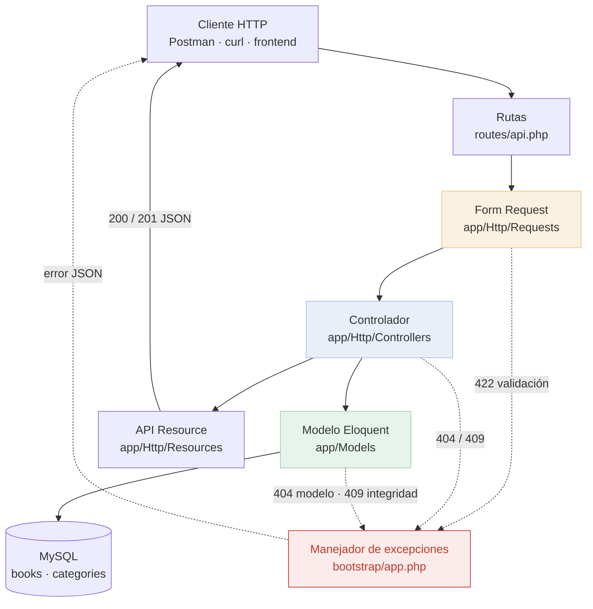
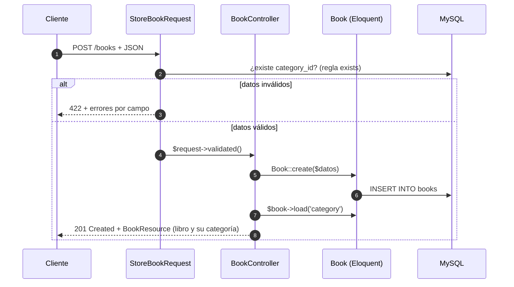
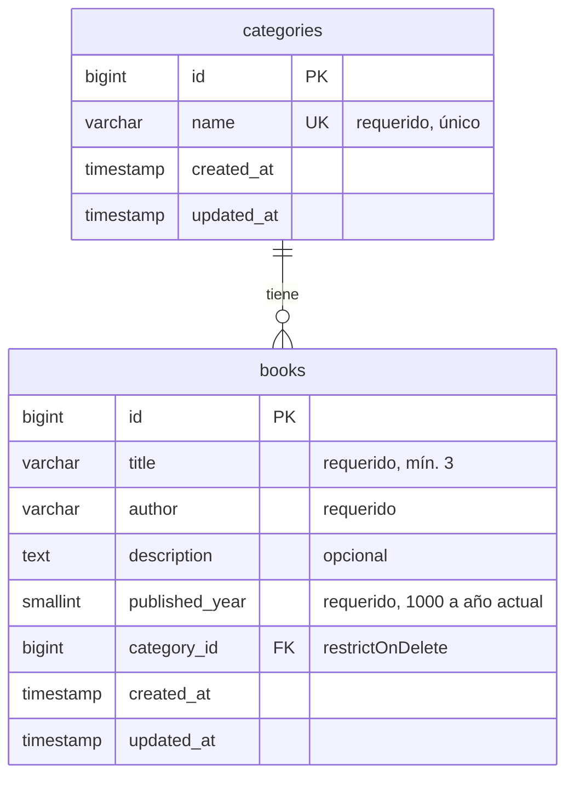

# Biblioteca API — Prueba técnica Laravel

API REST para gestionar una biblioteca de libros y sus categorías, construida con **Laravel 13** y **PHP 8.5**.

Permite listar, crear, editar y eliminar libros, filtrarlos por categoría y administrar categorías, con validación mediante Form Requests y respuestas/errores HTTP en JSON.

## Índice

1. [Requisitos](#requisitos)
2. [Instalación](#instalación)
3. [Tests](#tests)
4. [Arquitectura](#arquitectura)
5. [Ciclo de vida de una petición](#ciclo-de-vida-de-una-petición)
6. [Modelo de datos](#modelo-de-datos)
7. [Endpoints](#endpoints)
8. [Validaciones](#validaciones)
9. [Reglas de negocio](#reglas-de-negocio)
10. [Manejo de errores HTTP](#manejo-de-errores-http)
11. [Decisiones de diseño](#decisiones-de-diseño)
12. [Estructura del proyecto](#estructura-del-proyecto)
13. [Flujo de trabajo con Git](#flujo-de-trabajo-con-git)

## Requisitos

- PHP >= 8.3 con extensiones `pdo_mysql`, `mbstring`, `xml`, `intl`
- Composer 2
- MySQL 8+ (o MariaDB). Los tests usan SQLite en memoria, sin configuración extra.

## Instalación

```bash
git clone https://github.com/oeRusso/prueba-tecnica-biblioteca.git
cd prueba-tecnica-biblioteca

composer install
cp .env.example .env
php artisan key:generate
```

Crear la base de datos y configurar las credenciales en `.env`:

```sql
CREATE DATABASE biblioteca CHARACTER SET utf8mb4 COLLATE utf8mb4_unicode_ci;
CREATE USER 'biblioteca'@'localhost' IDENTIFIED BY 'biblioteca_pass';
GRANT ALL PRIVILEGES ON biblioteca.* TO 'biblioteca'@'localhost';
```

```dotenv
DB_CONNECTION=mysql
DB_HOST=127.0.0.1
DB_PORT=3306
DB_DATABASE=biblioteca
DB_USERNAME=biblioteca
DB_PASSWORD=biblioteca_pass
```

Ejecutar migraciones con datos de ejemplo y levantar el servidor:

```bash
php artisan migrate --seed
php artisan serve
```

La API queda disponible en `http://127.0.0.1:8000`. Los seeders cargan 6 categorías (Novela, Ciencia ficción, Fantasía, Historia, Tecnología, Poesía) y 9 libros reales. Usan `firstOrCreate`, así que se pueden ejecutar varias veces sin duplicar datos.

## Tests

```bash
php artisan test
# Tests: 28 passed (96 assertions)
```

Hay 28 tests de feature que hacen peticiones HTTP reales contra la aplicación. Usan SQLite en memoria con `RefreshDatabase`, así que cada test parte de una base limpia y no toca los datos de MySQL.

| Archivo | Qué cubre |
|---|---|
| `tests/Feature/BookTest.php` | Listar con categoría; filtrar por categoría; filtro con categoría inexistente (422); crear (201) y descripción opcional; **9 casos inválidos** con *data provider* (título ausente o corto, autor ausente, año ausente, no numérico, de 3 dígitos o futuro, categoría ausente o inexistente); mostrar; actualizar y validar al actualizar; actualizar o eliminar un libro inexistente (404); eliminar (200) |
| `tests/Feature/CategoryTest.php` | Listar con `books_count`; crear (201); nombre obligatorio y único (422); actualizar conservando el mismo nombre (200); eliminar con libros (409); eliminar sin libros (200); eliminar inexistente (404) |

## Arquitectura

El diseño sigue el patrón **MVC** de Laravel, adaptado a una API JSON. La "Vista" no es una plantilla HTML sino un **API Resource** que define cómo se ve cada objeto en JSON. Cada capa tiene una sola responsabilidad: el controlador nunca valida a mano, el modelo nunca construye respuestas HTTP y el Resource nunca consulta la base de datos.



| Capa | Archivos | Responsabilidad |
|---|---|---|
| Ruteo | `routes/api.php` | Asocia cada verbo HTTP + URL a un método de controlador. Restringe `{id}` a números. |
| Validación | `app/Http/Requests/*` | Reglas de entrada y mensajes en español. Desacopla la validación del controlador. |
| Controlador | `app/Http/Controllers/*` | Flujo de la operación, reglas de negocio y código de estado HTTP. |
| Modelo / ORM | `app/Models/*` | Mapeo de tablas, relaciones, *casts*, atributos asignables y scopes. |
| Presentación | `app/Http/Resources/*` | Transformación a JSON con estructura estable (`{"data": ...}`). |
| Errores | `bootstrap/app.php` | Convierte excepciones en respuestas JSON uniformes. |
| Persistencia | `database/migrations`, `seeders`, `factories` | Esquema versionado, datos de ejemplo y datos falsos para tests. |

## Ciclo de vida de una petición

Ejemplo: `POST /books` para crear un libro.



1. **Ruteo:** Laravel encuentra `POST /books → BookController@store`.
2. **Validación:** el controlador declara `StoreBookRequest` como parámetro, así que Laravel lo ejecuta antes. Si algo falla, lanza `ValidationException` y el manejador responde 422; el controlador ni siquiera se ejecuta.
3. **Controlador:** recibe solo datos validados con `$request->validated()` y nunca usa `$request->all()`, así se evita la asignación masiva de campos no esperados.
4. **Modelo:** `Book::create()` solo acepta los atributos declarados en `#[Fillable]`.
5. **Respuesta:** se carga la relación `category` y el `BookResource` la serializa. Se devuelve **201 Created**.

## Modelo de datos



| Tabla        | Campo            | Tipo                      | Reglas                              |
|--------------|------------------|---------------------------|-------------------------------------|
| `categories` | `id`             | BigInt autoincremental PK |                                     |
|              | `name`           | String                    | Requerido, **único**                |
| `books`      | `id`             | BigInt autoincremental PK |                                     |
|              | `title`          | String                    | Requerido, mínimo 3 caracteres      |
|              | `author`         | String                    | Requerido                           |
|              | `description`    | Text                      | Opcional                            |
|              | `published_year` | SmallInt unsigned         | Requerido, año válido (1000–actual) |
|              | `category_id`    | BigInt FK → `categories`  | Requerido, debe existir             |

**Relaciones Eloquent:** una categoría tiene muchos libros (`Category hasMany Book`) y cada libro pertenece a una categoría (`Book belongsTo Category`). El filtro por categoría está en un scope reutilizable:

```php
// app/Models/Book.php
#[Scope]
protected function ofCategory(Builder $query, int $categoryId): void
{
    $query->where('category_id', $categoryId);
}

// uso: Book::ofCategory(2)->get();
```

Las migraciones crean primero `categories` y después `books`, porque `books` depende de ella. La FK se declara con `foreignId('category_id')->constrained()->restrictOnDelete()`, así que **la propia base de datos** impide borrar una categoría con libros.

## Endpoints

Todas las respuestas son JSON. Se recomienda enviar `Accept: application/json` y `Content-Type: application/json`.

### Libros

| Método   | Ruta                           | Descripción                   | Éxito | Errores    |
|----------|--------------------------------|-------------------------------|-------|------------|
| `GET`    | `/books`                       | Lista todos los libros        | 200   |            |
| `GET`    | `/books?category={category_id}`| Filtra libros por categoría   | 200   | 422        |
| `POST`   | `/books`                       | Crea un libro                 | 201   | 422        |
| `GET`    | `/books/{id}`                  | Muestra un libro              | 200   | 404        |
| `PUT`    | `/books/{id}`                  | Actualiza un libro            | 200   | 404, 422   |
| `DELETE` | `/books/{id}`                  | Elimina un libro              | 200   | 404        |

### Categorías

| Método   | Ruta                | Descripción                                  | Éxito | Errores       |
|----------|---------------------|----------------------------------------------|-------|---------------|
| `GET`    | `/categories`       | Lista categorías con cantidad de libros      | 200   |               |
| `POST`   | `/categories`       | Crea una categoría (nombre único)            | 201   | 422           |
| `GET`    | `/categories/{id}`  | Muestra una categoría                        | 200   | 404           |
| `PUT`    | `/categories/{id}`  | Actualiza una categoría                      | 200   | 404, 422      |
| `DELETE` | `/categories/{id}`  | Elimina una categoría **sin libros**         | 200   | 404, 409      |

### Ejemplos

```bash
# Listar y filtrar
curl http://127.0.0.1:8000/books
curl "http://127.0.0.1:8000/books?category=1"

# Crear
curl -X POST http://127.0.0.1:8000/books \
  -H "Content-Type: application/json" -H "Accept: application/json" \
  -d '{"title":"El Aleph","author":"Jorge Luis Borges","published_year":1949,"category_id":1}'

# Actualizar
curl -X PUT http://127.0.0.1:8000/books/1 \
  -H "Content-Type: application/json" -H "Accept: application/json" \
  -d '{"title":"Cien años de soledad","author":"Gabriel García Márquez","published_year":1967,"category_id":1}'

# Eliminar
curl -X DELETE http://127.0.0.1:8000/books/1
```

Respuesta de creación (`201 Created`):

```json
{
  "data": {
    "id": 10,
    "title": "El Aleph",
    "author": "Jorge Luis Borges",
    "description": null,
    "published_year": 1949,
    "category_id": 1,
    "category": { "id": 1, "name": "Novela" },
    "created_at": "2026-11-24T22:26:50.000000Z",
    "updated_at": "2026-11-24T22:26:50.000000Z"
  }
}
```

## Validaciones

Toda la validación vive en clases `FormRequest`, fuera del controlador. Cada una define `rules()`, `messages()` (mensajes en español) y `attributes()` (nombres legibles de los campos).

| Campo | Reglas Laravel | Qué garantiza |
|---|---|---|
| `title` | `required\|string\|min:3\|max:255` | Obligatorio, mínimo 3 caracteres |
| `author` | `required\|string\|max:255` | Obligatorio |
| `description` | `nullable\|string` | Opcional |
| `published_year` | `required\|integer\|digits:4\|min:1000\|max:{año actual}` | Año válido de 4 dígitos, no futuro |
| `category_id` | `required\|integer\|exists:categories,id` | Debe existir en `categories` |
| `category` (query de `GET /books`) | `nullable\|integer\|exists:categories,id` | El filtro solo acepta categorías existentes |
| `name` (categoría) | `required\|string\|max:255\|unique:categories,name` | Nombre único al registrar |

- `UpdateBookRequest` hereda de `StoreBookRequest`, porque `PUT` reemplaza el recurso completo y las reglas son las mismas.
- `UpdateCategoryRequest` redefine la regla de unicidad con `Rule::unique(...)->ignore($id)`; si no lo hiciera, guardar una categoría sin cambiar su nombre fallaría como "duplicada".

Error de validación (`422 Unprocessable Content`):

```json
{
  "message": "Los datos enviados no son válidos.",
  "errors": {
    "title": ["El título debe tener al menos 3 caracteres."],
    "published_year": ["El año de publicación no puede ser posterior a 2026."],
    "category_id": ["La categoría seleccionada no existe."]
  }
}
```

## Reglas de negocio

**1. Verificar que el libro exista antes de eliminarlo.** En `BookController::destroy` la comprobación es explícita en el código, para que se lea claramente:

```php
$book = Book::find($id);

if (! $book) {
    return response()->json(['message' => "El libro con ID {$id} no existe."], 404);
}

$book->delete();

return response()->json(['message' => 'Libro eliminado correctamente.'], 200);
```

**2. No eliminar una categoría con libros asociados.** En `CategoryController::destroy` se consulta la relación antes de borrar y se responde **409 Conflict**:

```php
if ($category->books()->exists()) {
    return response()->json([
        'message' => 'No se puede eliminar la categoría porque tiene libros asociados.',
        'books_count' => $category->books()->count(),
    ], 409);
}

$category->delete();
```

> **Defensa en profundidad:** la regla de categorías se aplica en dos niveles. La aplicación la valida y responde 409 con un mensaje claro. Además, la FK con `restrictOnDelete` impide el borrado en la base de datos, aunque alguien saltara el controlador.

## Manejo de errores HTTP

Todos los errores se centralizan en `bootstrap/app.php` (`withExceptions`), así el formato es el mismo en toda la API y los controladores no necesitan `try/catch`. `shouldRenderJsonWhen(fn () => true)` garantiza JSON aunque el cliente no envíe `Accept: application/json`.

| Código | Significado | Cuándo ocurre | Origen |
|---|---|---|---|
| **200** | OK | Listar, mostrar, actualizar, eliminar | Controlador |
| **201** | Created | Libro o categoría creados | Controlador |
| **404** | Not Found | ID inexistente o ruta desconocida (incluye `/books/abc`) | Route model binding / `find()` / handler |
| **405** | Method Not Allowed | Verbo no soportado (p. ej. `PATCH /books`) | Handler |
| **409** | Conflict | Eliminar categoría con libros; violación de integridad en BD | Controlador / handler (`QueryException`) |
| **422** | Unprocessable Content | Datos de entrada inválidos | Form Request / handler |

Para los 404 de modelos, el manejador inspecciona la `ModelNotFoundException` original e identifica qué recurso faltaba, así el mensaje es específico:

```json
{ "message": "El libro con ID 999 no existe." }
```

## Decisiones de diseño

| Decisión | Motivo |
|---|---|
| Rutas sin prefijo `/api` (`apiPrefix: ''`) | El enunciado pide exactamente `/books`. Se usa el grupo de middleware `api` (sin sesión ni CSRF), adecuado para una API sin estado. |
| API Resources en vez de devolver el modelo | Controlan exactamente qué se expone, evitan filtrar columnas internas y dan una estructura estable (`data`) aunque cambie la tabla. |
| Carga anticipada (`with('category')`) | Evita el problema N+1: el listado ejecuta 2 consultas en lugar de 1 + N. |
| Scope `ofCategory` + `when()` | El filtro es opcional y la consulta queda legible y reutilizable. |
| Route model binding en `show` / `update` | Laravel resuelve el modelo y responde 404 automáticamente. En `destroy` la verificación se hizo explícita porque el enunciado la pide como regla de negocio. |
| `{id}` restringido a números | `/books/abc` responde 404 limpio en lugar de un error interno 500. |
| `#[Fillable]` + `validated()` | Doble protección contra asignación masiva: solo entran campos declarados y validados. |
| `published_year` como `SMALLINT UNSIGNED` | El tipo `YEAR` de MySQL solo admite 1901–2155, y libros como *Don Quijote* (1605) no cabrían. `SMALLINT` admite cualquier año de 4 dígitos. |
| CRUD de categorías incluido | No se pide como endpoint, pero sin él no se podían ejercitar las reglas "nombre único" y "no eliminar con libros". |
| Mensajes en español | Coherencia con el dominio y mejor experiencia para quien consume la API. |

## Estructura del proyecto

```
app/
├── Http/
│   ├── Controllers/
│   │   ├── BookController.php          index · store · show · update · destroy
│   │   └── CategoryController.php      index · store · show · update · destroy
│   ├── Requests/
│   │   ├── IndexBookRequest.php        valida ?category=
│   │   ├── StoreBookRequest.php        reglas + mensajes del libro
│   │   ├── UpdateBookRequest.php       hereda de StoreBookRequest (PUT = reemplazo)
│   │   ├── StoreCategoryRequest.php    nombre requerido y único
│   │   └── UpdateCategoryRequest.php   único, ignorando la propia categoría
│   └── Resources/
│       ├── BookResource.php            JSON del libro (+ categoría anidada)
│       └── CategoryResource.php        JSON de la categoría (+ books_count)
└── Models/
    ├── Book.php                        belongsTo Category · scope ofCategory
    └── Category.php                    hasMany Book
bootstrap/app.php                       rutas API sin prefijo + manejo de errores JSON
database/
├── migrations/                         create_categories_table · create_books_table
├── factories/                          BookFactory · CategoryFactory (datos de prueba)
└── seeders/                            CategorySeeder · BookSeeder · DatabaseSeeder
routes/api.php                          apiResource books / categories
tests/Feature/                          BookTest · CategoryTest (28 tests)
```

## Flujo de trabajo con Git

- **`development`**: recibe el trabajo en commits pequeños por capa (base de datos → endpoints → documentación).
- **`main`**: se actualiza solo cuando todo está verificado, así siempre contiene una versión estable para entregar.
